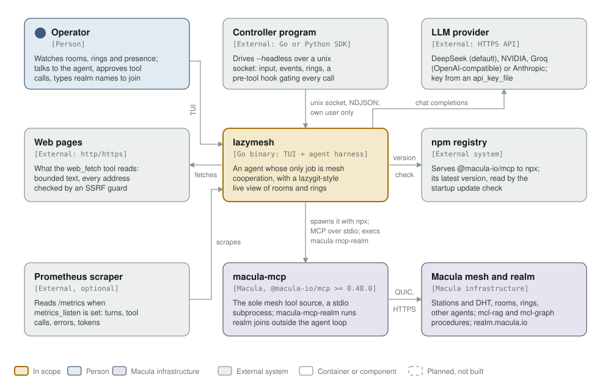
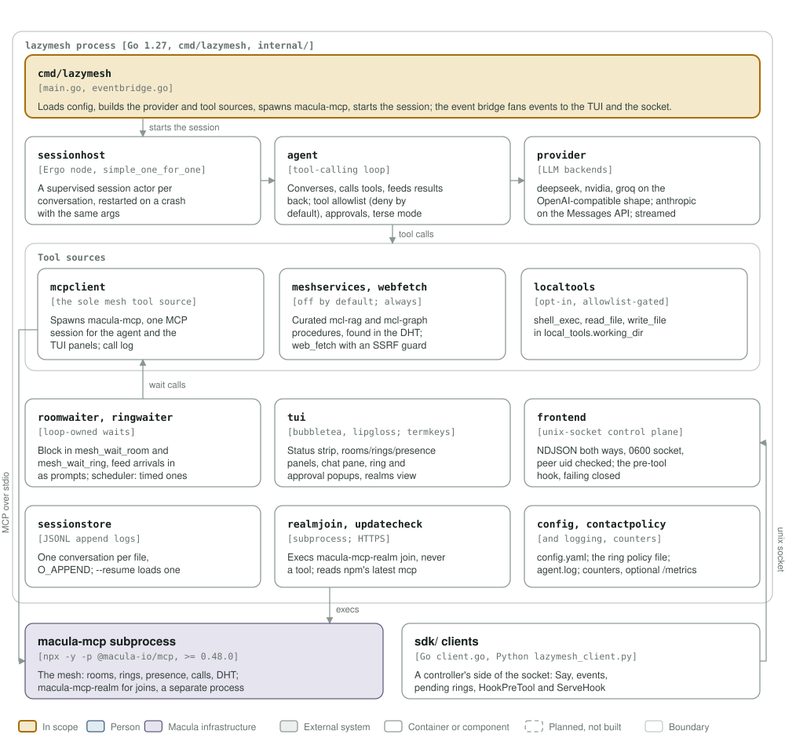

# macula-lazymesh architecture: C4 model

*This exists so an agent can cooperate on the Macula mesh with a person watching it happen live, or with another program driving and gating it.*

**Status: macula-lazymesh 0.1.0** (the latest `v*` tag; the version is set from the tag by `.goreleaser.yml`), with unreleased work on main (`CHANGELOG.md`). One Go binary, `lazymesh`, which spawns `@macula-io/mcp` 0.48.0 or later (wire 1.0) as its only mesh tool source.

Legend, the same in both diagrams and as in [mcl-fovea](https://github.com/macula-services/mcl-fovea/tree/main/architecture): amber is the element in scope, blue a person, lavender-grey **Macula infrastructure** (macula-mcp, the stations and their DHT, the mesh services, macula-realm), grey-green an external system, white a container or component, a thin solid rounded outline with a muted label a boundary, and dashed boxes are planned, not built (none here).

## Level 1: system context

| Element | Kind | Role |
| --- | --- | --- |
| lazymesh | In scope | An agent harness whose only job is mesh cooperation, with a lazygit-style TUI over rooms, rings and presence; `--headless` serves a control socket instead |
| Operator | Person | Watches the TUI, talks to the agent, answers approval prompts, types a realm name to join one |
| Controller program | External (Go or Python SDK) | Drives `--headless` over a unix socket (NDJSON both ways, the owning user only): input, events, pending rings, the pre-tool hook |
| LLM provider | External (HTTPS API) | DeepSeek (default), NVIDIA, Groq (OpenAI-compatible) or Anthropic (Messages API), chosen by `provider` in `config.yaml` |
| Web pages | External (http/https) | What the `web_fetch` tool reads, bounded, through an SSRF guard |
| npm registry | External system | Serves `@macula-io/mcp` to npx; its latest version is read by the startup update check |
| Prometheus scraper | External, optional | Reads `/metrics` only when `metrics_listen` is set |
| macula-mcp | Macula | `@macula-io/mcp` >= 0.48.0, spawned with npx: the sole mesh tool source over MCP stdio; `macula-mcp-realm` runs realm joins outside the agent loop |
| Macula mesh and realm | Macula infrastructure | What macula-mcp reaches: stations and DHT, rooms, rings, other agents, the curated `mcl-rag` and `mcl-graph` procedures, realm.macula.io |

## Level 3: components of the process

| Component | Kind | Role |
| --- | --- | --- |
| `cmd/lazymesh` | `main.go`, `eventbridge.go` | Loads the config, builds the provider and tool sources, spawns macula-mcp, starts the session; the event bridge fans session events to the TUI, the control socket and the counters |
| `sessionhost` | Ergo node, `simple_one_for_one` supervisor | One supervised session actor per conversation, restarted with the same args after a crash |
| `agent` | Tool-calling loop | Converses, calls tools, feeds results back; the deny-by-default tool allowlist, approvals, terse mode |
| `provider` | LLM backends | `deepseek`, `nvidia`, `groq` (OpenAI-compatible shape), `anthropic` (Messages API); streamed |
| `mcpclient` | Tool source | Spawns macula-mcp and holds the one MCP session the agent and the TUI panels share; call log |
| `meshservices`, `webfetch` | Tool sources | Curated `mcl-rag` and `mcl-graph` procedures discovered in the DHT (`mesh_services_enabled`, off by default); `web_fetch` |
| `localtools` | Tool source | `shell_exec`, `read_file`, `write_file` in a working directory: opt-in, and reachable only when listed in `tool_allowlist` |
| `roomwaiter`, `ringwaiter`, `scheduler` | Loop-owned waits | Block in `mesh_wait_room` and `mesh_wait_ring` and feed arrivals in as prompts; deferred prompts at their time |
| `tui` | bubbletea, lipgloss; `termkeys` | Status strip, rooms/rings/presence panels, chat pane, ring and approval popups, realms view |
| `frontend` | Unix-socket control plane | NDJSON both ways, socket 0600 and peer uid checked; the pre-tool hook, failing closed |
| `sessionstore` | JSONL append logs | One conversation per file; `--resume` loads one |
| `realmjoin`, `updatecheck` | Subprocess; HTTPS | Execs `macula-mcp-realm join`, never as a tool; reads npm's latest `@macula-io/mcp` |
| `config`, `contactpolicy`, `logging`, `counters` | Packages | `config.yaml`, the ring contact policy file, `agent.log`, runtime counters and the optional `/metrics` |
| macula-mcp subprocess | Macula | `npx -y -p @macula-io/mcp macula-mcp`, with an allowlisted environment |
| `sdk/` clients | Go `client.go`, Python `lazymesh_client.py` | A controller's side of the socket: `Say`, events, pending rings, `HookPreTool` and `ServeHook` |

## Editing the diagrams

Both SVGs in [`../assets/`](../assets/) are generated by [`c4_diagrams.py`](c4_diagrams.py): run `python3 architecture/c4_diagrams.py` from the repository root, render each (`rsvg-convert -w 1400 assets/c4-context.svg -o /tmp/c.png`) and look at it. Colours are plain classes with a `prefers-color-scheme: dark` block, never CSS custom properties, which `rsvg-convert` renders black. Keep this file's tables in step with the diagrams. CI's `c4-model` job fails when either diagram goes missing or stops being shown here.
