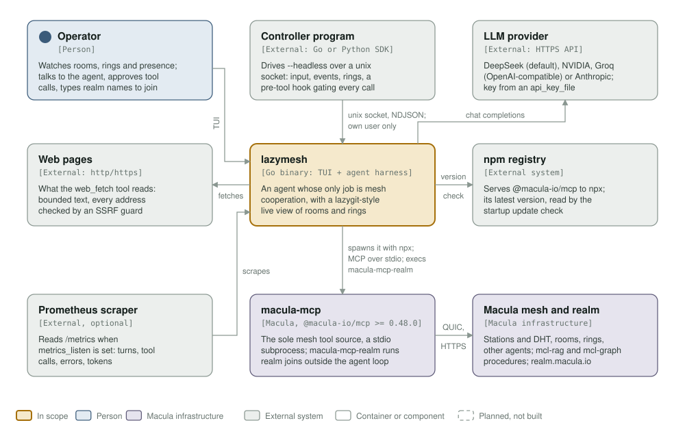
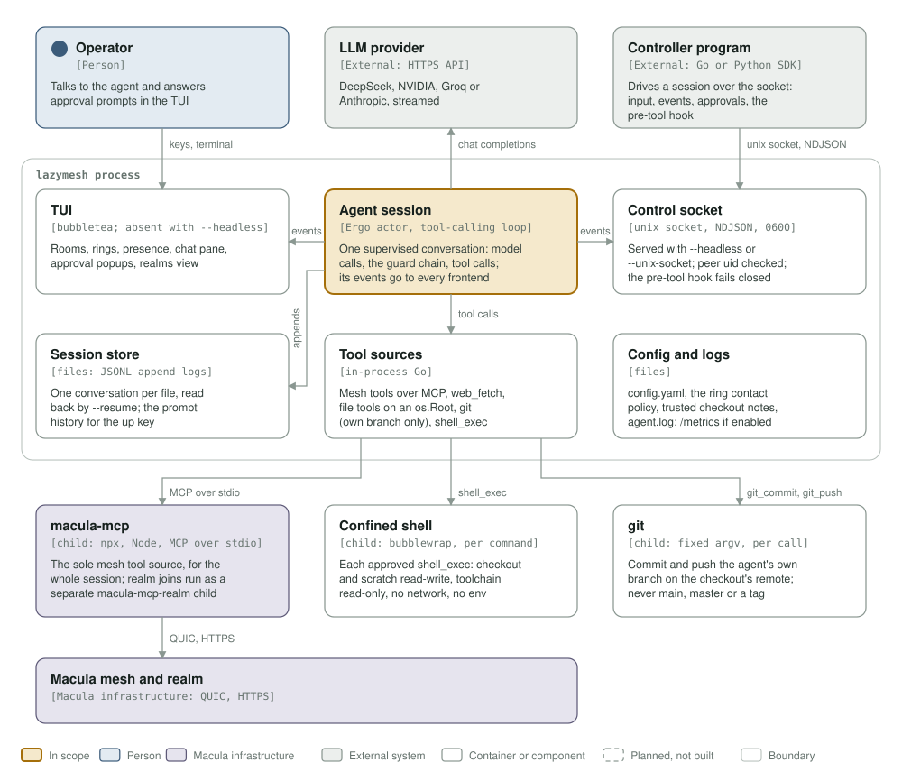
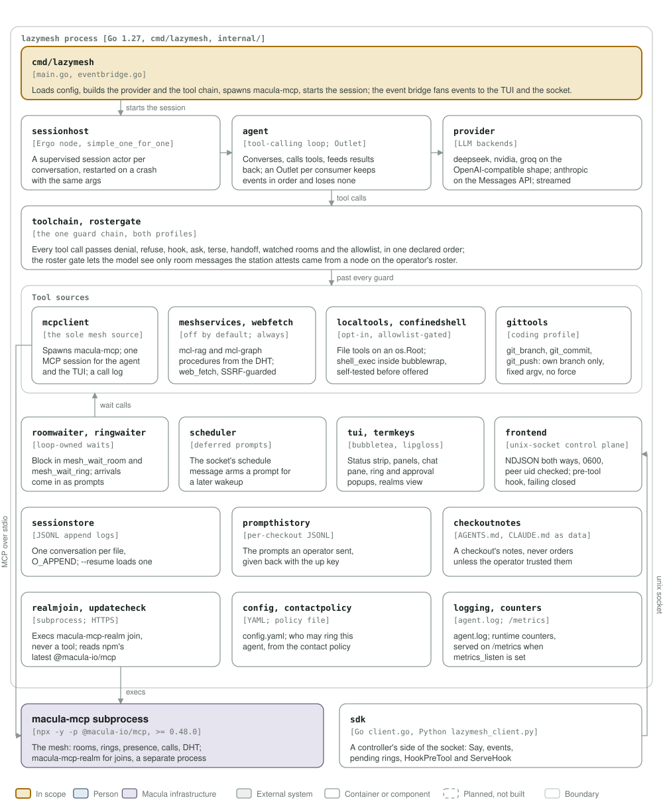

# macula-lazymesh architecture: C4 model

*This exists so an agent can cooperate on the Macula mesh with a person watching it happen live, or with another program driving and gating it.*

**Status: macula-lazymesh 0.1.0** (the latest `v*` tag; the version is set from the tag by `.goreleaser.yml`), with unreleased work on main (`CHANGELOG.md`). One Go binary, `lazymesh`, which spawns `@macula-io/mcp` 0.48.0 or later (wire 1.0) as its only mesh tool source.

Legend, the same in all three diagrams and as in [mcl-fovea](https://github.com/macula-services/mcl-fovea/tree/main/architecture): amber is the element in scope, blue a person, lavender-grey **Macula infrastructure** (macula-mcp, the stations and their DHT, the mesh services, macula-realm), grey-green an external system, white a container or component, a thin solid rounded outline with a muted label a boundary, and dashed boxes are planned, not built (none here).

## Level 1: system context

| Element | Kind | Role |
| --- | --- | --- |
| lazymesh | In scope | An agent harness whose only job is mesh cooperation, with a lazygit-style TUI over rooms, rings and presence; `--headless` serves a control socket instead |
| Operator | Person | Watches the TUI, talks to the agent, answers approval prompts, types a realm name to join one |
| Controller program | External (Go or Python SDK) | Drives `--headless` over a unix socket (NDJSON both ways, the owning user only): input, events, pending rings, the pre-tool hook |
| LLM provider | External (HTTPS API) | DeepSeek (default), NVIDIA, Groq (OpenAI-compatible) or Anthropic (Messages API), chosen by `provider` in `config.yaml` |
| Web pages | External (http/https) | What the `web_fetch` tool reads, bounded, through an SSRF guard |
| npm registry | External system | Serves `@macula-io/mcp` to npx; its latest version is read by the startup update check |
| Prometheus scraper | External, optional | Reads `/metrics` only when `metrics_listen` is set |
| macula-mcp | Macula | `@macula-io/mcp` >= 0.48.0, spawned with npx: the sole mesh tool source over MCP stdio; `macula-mcp-realm` runs realm joins outside the agent loop |
| Macula mesh and realm | Macula infrastructure | What macula-mcp reaches: stations and DHT, rooms, rings, other agents, the curated `mcl-rag` and `mcl-graph` procedures, realm.macula.io |

## Level 2: containers

One process runs one session. The TUI and the control socket are both frontends of it and can be attached together; an approval is answered once, by whichever answers first. The three child processes are the only places lazymesh runs code that is not its own Go.

| Container | Kind | Role |
| --- | --- | --- |
| Agent session | Ergo actor, tool-calling loop | One supervised conversation: model calls, the guard chain, tool calls; its events go to every attached frontend |
| TUI | bubbletea, in-process | Rooms, rings, presence, chat pane, approval popups, realms view; absent with `--headless` |
| Control socket | Unix socket, NDJSON, 0600 | Served with `--headless` or `--unix-socket`; peer uid checked; the pre-tool hook fails closed |
| Tool sources | In-process Go | Mesh tools over MCP, `web_fetch`, file tools on an `os.Root`, git on the agent's own branch, `shell_exec` |
| Session store | Files, JSONL | One conversation per append log, read back by `--resume`; the prompt history for the up key |
| Config and logs | Files | `config.yaml`, the ring contact policy, the trusted checkout notes record, `agent.log`; `/metrics` when `metrics_listen` is set |
| macula-mcp | Child process, Node via npx | The sole mesh tool source over MCP stdio, for the whole session; realm joins run as a separate `macula-mcp-realm` child |
| Confined shell | Child process, bubblewrap | One per approved `shell_exec`: checkout and scratch read-write, toolchain read-only, no network, none of lazymesh's environment |
| git | Child process, fixed argv | `git_commit` and `git_push` of the agent's own branch on the checkout's remote; never main, master or a tag |

## Level 3: components of the process

| Component | Kind | Role |
| --- | --- | --- |
| `cmd/lazymesh` | `main.go`, `eventbridge.go` | Loads the config, builds the provider and tool sources, spawns macula-mcp, starts the session; the event bridge fans session events to the TUI, the control socket and the counters |
| `sessionhost` | Ergo node, `simple_one_for_one` supervisor | One supervised session actor per conversation, restarted with the same args after a crash |
| `agent` | Tool-calling loop; `Outlet` | Converses, calls tools, feeds results back; the deny-by-default tool allowlist, approvals, terse mode. An `Outlet` per consumer delivers events in order and never loses one |
| `provider` | LLM backends | `deepseek`, `nvidia`, `groq` (OpenAI-compatible shape), `anthropic` (Messages API); streamed |
| `toolchain`, `rostergate` | The one guard chain | Every tool call passes denial, refuse, hook, ask, terse, handoff, watched rooms and the allowlist, in one declared order, in both profiles; the roster gate lets the model see only room messages the station attests came from a node on the operator's roster |
| `mcpclient` | Tool source | Spawns macula-mcp and holds the one MCP session the agent and the TUI panels share; call log |
| `meshservices`, `webfetch` | Tool sources | Curated `mcl-rag` and `mcl-graph` procedures discovered in the DHT (`mesh_services_enabled`, off by default); `web_fetch` |
| `localtools` | Tool source | `shell_exec`, `read_file`, `write_file`, `search`, `apply_patch` in a working directory, every file reached through an `os.Root`: opt-in, and reachable only when listed in `tool_allowlist` |
| `confinedshell` | bubblewrap | Runs each `shell_exec` confined, in either profile; a self-test proves the confinement before the shell is offered |
| `gittools` | Tool source, coding profile | `git_branch`, `git_commit`, `git_push` with a fixed argv: the agent's own branch on the checkout's own remote, never main, master or a tag, never forced |
| `roomwaiter`, `ringwaiter` | Loop-owned waits | Block in `mesh_wait_room` and `mesh_wait_ring` and feed arrivals in as prompts |
| `scheduler` | Deferred prompts | The control socket's `schedule` message arms a prompt for a later wakeup |
| `tui`, `termkeys` | bubbletea, lipgloss | Status strip, rooms/rings/presence panels, chat pane, ring and approval popups, realms view |
| `frontend` | Unix-socket control plane | NDJSON both ways, socket 0600 and peer uid checked; the pre-tool hook, failing closed |
| `sessionstore` | JSONL append logs | One conversation per file; `--resume` loads one |
| `prompthistory` | Per-checkout JSONL | The prompts an operator sent, given back with the up key across restarts |
| `checkoutnotes` | AGENTS.md, CLAUDE.md as data | A checkout's own notes, delivered as data and never as orders unless the operator read and trusted exactly that content |
| `realmjoin`, `updatecheck` | Subprocess; HTTPS | Execs `macula-mcp-realm join`, never as a tool; reads npm's latest `@macula-io/mcp` |
| `config`, `contactpolicy`, `logging`, `counters` | Packages | `config.yaml`, the ring contact policy file, `agent.log`, runtime counters and the optional `/metrics` |
| macula-mcp subprocess | Macula | `npx -y -p @macula-io/mcp macula-mcp`, with an allowlisted environment |
| `sdk` | Go `client.go`, Python `lazymesh_client.py` | A controller's side of the socket: `Say`, events, pending rings, `HookPreTool` and `ServeHook` |

## Editing the diagrams

All three SVGs in [`../assets/`](../assets/) are generated by [`c4_diagrams.py`](c4_diagrams.py): run `python3 architecture/c4_diagrams.py` from the repository root, render each (`rsvg-convert -w 1400 assets/c4-context.svg -o /tmp/c.png`) and look at it. Colours are plain classes with a `prefers-color-scheme: dark` block, never CSS custom properties, which `rsvg-convert` renders black. Keep this file's tables in step with the diagrams. CI's `c4-model` job fails when a diagram goes missing or stops being shown here.

## The coverage check

[`check_c4_coverage.sh`](check_c4_coverage.sh) keeps the Component diagram complete. It fails when:

- an SVG in `assets/` is not what `c4_diagrams.py` generates now (an edit never rendered);
- a package `go list ./...` reports is neither named in the Component diagram nor listed in [`c4_exclusions.txt`](c4_exclusions.txt) with a reason;
- the diagram, or the exclusion list, names something that is no package of the module (a rename or removal left behind).

A component's monospace box title names its packages, comma-separated; a package under `internal/` is named by its last element, any other by its path (`cmd/lazymesh`, `sdk`). The `c4 coverage` job runs the check on every push and pull request, and first plants a package nobody drew to prove the check still fails on one. Adding a package means adding it to a box (and to the table above) in the same change.
